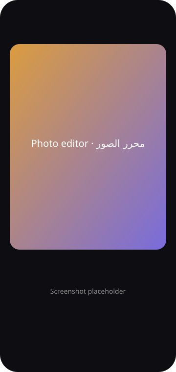
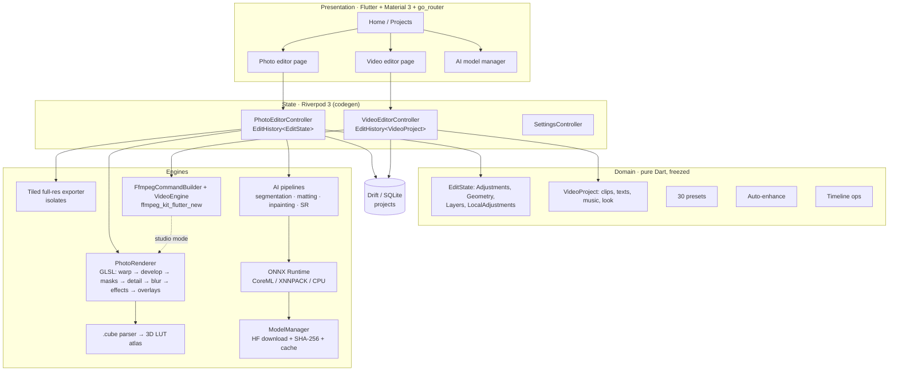

<div align="center">

# Lumora Studio · لومورا ستوديو

**Pro photo & video editing with on-device AI. 100% offline. No cloud, no accounts, no analytics.**

**تحرير احترافي للصور والفيديو بذكاء اصطناعي يعمل على جهازك. بدون إنترنت، بدون سحابة، بدون تتبّع.**

[](https://github.com/CTO-DRS/lumora-studio/actions/workflows/ci.yml)


[English](#english) · [العربية](#arabic)

| Home | Photo editor | AI tools | Video timeline |
|:---:|:---:|:---:|:---:|
|  |  |  |  |

<sub>Screenshot placeholders. Replace them with real captures from a device (see `docs/screenshots/README.md`).</sub>

</div>

---

<a name="english"></a>

## English

### Why Lumora?

- **Private by design.** Every pixel is processed on the device. AI models are downloaded once from public Hugging Face URLs, verified with SHA-256 and cached. Your media is never uploaded.
- **GPU-first.** All photo adjustments are real GLSL fragment shaders (Flutter `FragmentProgram`, Impeller), so the preview updates in real time and the export matches it pixel for pixel.
- **Non-destructive.** Every edit is a serializable recipe (`EditState`) with unlimited undo/redo. Projects are saved locally (Drift/SQLite) and can be reopened at any time.
- **Arabic and English.** Fully localized, with right-to-left layout and correct Arabic shaping, even in text burned into video.

### Features

#### Photo
| Area | What you get |
|---|---|
| Light | Exposure (EV, linear light), contrast (S-curve), highlights, shadows, whites, blacks |
| Color | Temperature/tint (white balance in linear light), vibrance, saturation, **8-band HSL mixer**, split toning, fade |
| Curves | RGB master + per-channel R/G/B curves (monotone cubic, no overshoot) |
| Detail | Sharpen (luma unsharp mask), clarity, structure, dehaze (dark-channel prior), gaussian blur |
| Effects | Vignette (amount/size/roundness/feather), film grain (size, luminance-weighted), chromatic aberration, glitch, duotone |
| LUTs | `.cube` 3D LUT parser (sizes 2–65, DOMAIN support) → GPU atlas with trilinear lookup, intensity control, import your own LUTs, 3 bundled LUTs |
| Looks | **30 built-in presets** (film, cinematic, portrait, B&W, creative) with an intensity slider, layered on top of your own edits |
| Geometry | Crop with aspect presets and rule-of-thirds overlay, rotate 90°, straighten (auto-zoom), flip, vertical/horizontal perspective. All done in one inverse-homography shader pass |
| Layers | Text (RTL aware, bold, background pill, colour, size, opacity, rotation, pinch-to-scale), emoji and image stickers, free-hand drawing with eraser |
| Masks | Local adjustments through **brush**, **linear gradient**, **radial gradient** and an **AI subject** mask, each with its own exposure/contrast/colour/clarity/dehaze/blur, plus feather, invert and amount |
| Compare | Press and hold to see the original |
| Export | Full resolution JPEG / PNG / WebP / HEIC, quality control, optional EXIF copy (camera, lens, exposure, GPS, dates; orientation reset). Images larger than 8192 px are exported **tile by tile** (CPU geometry on an isolate, GPU colour pipeline per tile) |

#### On-device AI (ONNX Runtime)
| Tool | Model | Pipeline |
|---|---|---|
| Background removal | U²-Net-p (4.6 MB) | ImageNet norm → 320² → sigmoid → min-max → bilinear upsample → alpha |
| Portrait cutout / subject mask | MODNet int8 (6.6 MB) | short side 512, multiples of 32, mean = std = 0.5 → alpha matte |
| Blur background / portrait retouch | MODNet | subject mask → masked local adjustment (blur, or skin smoothing) |
| Object eraser | MI-GAN (28 MB, default) or LaMa (208 MB, highest quality) | mask dilation → context crop around the strokes → model → feathered composite at full resolution |
| Upscale 4× | Real-ESRGAN General x4v3 (4.9 MB) | 128 px tiles with 16 px overlap → feather-blended stitching |
| Auto enhance | Deterministic | histogram percentiles, gray-world white balance, adaptive vibrance |

Models are listed in `lib/features/ai/domain/model_registry.dart` with their URL, SHA-256, size and license. Downloads are streamed, hashed on the fly and only kept if the checksum matches. Accelerated execution providers (CoreML on iOS, XNNPACK on Android) are used when available, with fallback to CPU.

#### Video
- Multi-clip timeline with filmstrip thumbnails, pinch-to-zoom and a centre playhead (scrolling scrubs the video)
- Trim, **split at playhead**, merge/reorder, duplicate, delete
- Speed 0.25×–4× (with `atempo` chaining for audio), reverse, crop presets, rotate
- 9 transitions (`xfade`: fade, dissolve, wipes, slides, circle, zoom, pixelize) with audio cross-fades
- The **same looks and presets as photos**: a real-time preview through a fragment shader on the video texture (`ImageFilter.shader`, Impeller)
- Text overlays rendered by Flutter, so Arabic shaping and emoji are correct, then composited by FFmpeg with start/end times
- Background music with volume, fade in/out and looping, mixed with the original audio (per-clip volume)
- Output aspect (16:9, 9:16, 1:1, 4:3, 4:5), resolution (480p–4K) and frame rate (24/30/60)
- Two export modes:
  - **Fast**: the look is mapped to native FFmpeg filters (`exposure`, `colortemperature`, `eq`, `vibrance`, `curves`, `lut3d`, `unsharp`, `gblur`, `vignette`, `noise`, `rgbashift`)
  - **Studio**: every frame goes through the GPU photo pipeline, for an exact match with the photo editor (HSL, split toning, duotone, glitch and the rest)

### Architecture

Feature-first clean architecture: `domain` (pure Dart, immutable `freezed` models, fully unit tested), `engine`/`data` (GPU, FFmpeg, ONNX, Drift) and `presentation` (Riverpod 3 notifiers with code generation, widgets).



The full write-up, including the render pass order, the GLES y-flip convention and the tiling strategy, is in [`docs/ARCHITECTURE.md`](docs/ARCHITECTURE.md). Dependency choices are explained in [`docs/DEPENDENCIES.md`](docs/DEPENDENCIES.md).

### Tech stack (verified on pub.dev, November 2026)

| Concern | Package |
|---|---|
| UI | Flutter 3.50 · Dart 3.14 · `material_ui` 1.11 (Material 3; Material is now a separate package) · Impeller |
| State | `flutter_riverpod` 3.5 + `riverpod_generator` 4.0 |
| Routing | `go_router` 18.1 |
| Models | `freezed` 4.0 / `json_serializable` 6.15 |
| Persistence | `drift` 2.35 + `drift_flutter` 0.3, `shared_preferences` |
| AI runtime | `flutter_onnxruntime` 1.9 |
| Video engine | `ffmpeg_kit_flutter_new_min_gpl` 2.7 (FFmpeg 8.1.2) |
| Playback | `video_player` 2.14 |
| Image IO | `image` 4.13, `flutter_image_compress` 2.5 (WebP/HEIC), `native_exif` 0.8, `gal` 3.0 |
| Lints | `very_good_analysis` 11 |

### Build & run

```bash
# Flutter 3.50 stable (Dart 3.14)
flutter pub get
dart run build_runner build      # freezed / json / riverpod / drift
flutter gen-l10n                  # Arabic + English
flutter analyze
flutter test                      # unit + widget + real GPU shader tests

flutter run                       # device or emulator
flutter build apk --release --split-per-abi
flutter build ios --release --no-codesign
```

Requirements: Android 8.0+ (API 26; HEIC export needs API 28+) and iOS 16+. Shader effects need Impeller, which is the default on both platforms.

CI (`.github/workflows/ci.yml`) runs code generation, format, analyze and tests, then builds split-per-ABI Android APKs and an unsigned iOS app. Dependabot keeps pub, Gradle and Actions dependencies up to date.

### Licensing note

Lumora's source code is MIT. The default video engine package, `ffmpeg_kit_flutter_new_min_gpl`, bundles x264 (GPL), so **binaries you distribute with it are covered by the GPL-3.0**. For MIT/LGPL-only binaries, swap to `ffmpeg_kit_flutter_new_min` and use `VideoEncoder.mediacodec` / `VideoEncoder.videotoolbox`; the API is identical. AI models keep their own licenses, listed in the model manager screen and in `model_registry.dart`.

---

<a name="arabic"></a>

<div dir="rtl">

## العربية

### لماذا لومورا؟

- **الخصوصية أولاً:** تتم معالجة كل بكسل على جهازك. تُنزَّل نماذج الذكاء الاصطناعي مرة واحدة من روابط Hugging Face العامة، ويُتحقق منها بـ SHA-256 ثم تُحفظ محلياً. صورك ومقاطعك لا تُرفع أبداً.
- **معالجة على كرت الشاشة:** كل تعديلات الصور مكتوبة كـ GLSL Shaders حقيقية (Flutter FragmentProgram مع Impeller)، لذلك تتحدث المعاينة فوراً، ويطابق التصدير ما تراه تماماً.
- **تحرير غير متلف:** كل تعديل وصفة قابلة للحفظ، مع تراجع وإعادة بلا حدود. تُحفظ المشاريع محلياً (Drift/SQLite) ويمكن فتحها لاحقاً.
- **عربي وإنجليزي:** واجهة مترجمة بالكامل مع دعم الاتجاه من اليمين لليسار، وتشكيل صحيح للحروف العربية حتى في نصوص الفيديو.

### المزايا

**الصور:**
- الإضاءة: التعريض، التباين، الإضاءات العالية، الظلال، الأبيض، الأسود
- الألوان: الحرارة والصبغة، الحيوية، التشبع، **خلاط HSL بثمانية نطاقات**، التلوين المنفصل، البهتان
- المنحنيات: منحنى عام ومنحنيات منفصلة للأحمر والأخضر والأزرق
- التفاصيل: الحدة، الوضوح، البنية، إزالة الضباب، التمويه
- التأثيرات: التظليل الجانبي، الحبيبات، الانحراف اللوني، التشويش الرقمي، الثنائي اللوني
- جداول الألوان LUT: قراءة ملفات ‎.cube وتطبيقها على GPU، مع إمكانية استيراد ملفاتك
- **30 نمطاً جاهزاً** (أفلام، سينمائي، بورتريه، أبيض وأسود، إبداعي) مع التحكم في الشدة
- القص والتدوير وتعديل الميل والقلب وتصحيح المنظور
- النصوص (تدعم العربية) والملصقات والرسم الحر
- الأقنعة: فرشاة، تدرج خطي، تدرج دائري، وقناع العنصر بالذكاء الاصطناعي
- المقارنة قبل وبعد بالضغط المطوّل
- التصدير بالدقة الكاملة بصيغ JPEG وPNG وWebP وHEIC مع الاحتفاظ ببيانات EXIF اختيارياً، وتقسيم الصور الضخمة إلى مربعات

**الذكاء الاصطناعي على الجهاز:**
- إزالة الخلفية (U²-Net) وقص الأشخاص (MODNet)
- تمويه الخلفية وتنقيح البورتريه
- ممحاة العناصر (MI-GAN أو LaMa)
- تكبير الصور 4× (Real-ESRGAN)
- التحسين التلقائي

**الفيديو:**
- خط زمني متعدد المقاطع مع صور مصغرة
- قص المدة، التقسيم، الدمج وإعادة الترتيب، التكرار، الحذف
- السرعة من 0.25× إلى 4×، العكس، القص، التدوير
- 9 انتقالات بين المقاطع مع مزج الصوت
- نفس أنماط وفلاتر الصور مع معاينة فورية على كرت الشاشة
- نصوص فوق الفيديو بخطوط عربية صحيحة
- موسيقى خلفية مع التحكم في الصوت والتلاشي
- نسب العرض (16:9، 9:16، 1:1، 4:3، 4:5) والدقة حتى 4K
- تصدير سريع بفلاتر FFmpeg، أو تصدير «استوديو» يطابق محرر الصور تماماً

### البناء والتشغيل

</div>

```bash
flutter pub get
dart run build_runner build
flutter gen-l10n
flutter test
flutter run
```

<div dir="rtl">

يتطلب Android 8.0 أو أحدث، وiOS 16 أو أحدث. تفاصيل البنية في `docs/ARCHITECTURE.md`، وخارطة الطريق في `ROADMAP.md`، ونرحب بمساهماتكم (راجع `CONTRIBUTING.md`).

**الترخيص:** الكود المصدري مرخّص بـ MIT. انتبه إلى أن حزمة FFmpeg الافتراضية تتضمن x264 المرخّص بـ GPL، لذا تخضع النسخ التنفيذية الموزعة لـ GPL-3.0. يمكنك التبديل إلى نسخة LGPL كما هو موضح في القسم الإنجليزي.

</div>

---

© 2026 CTO-DRS · MIT License
