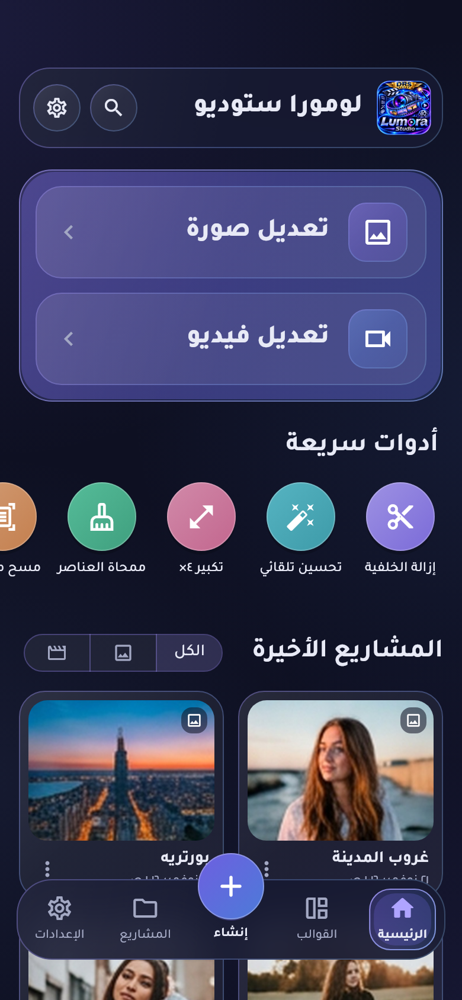
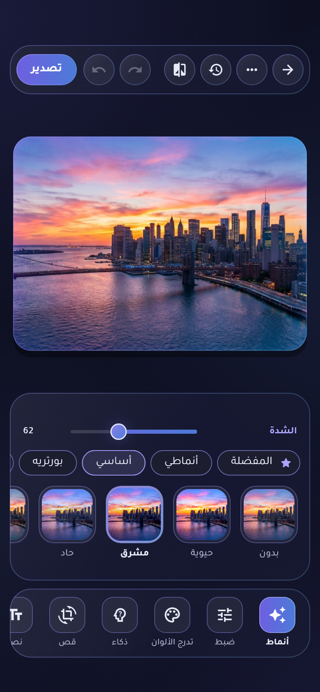
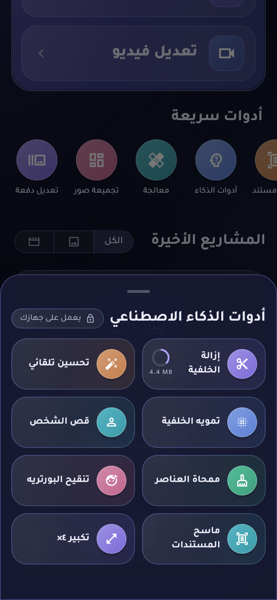
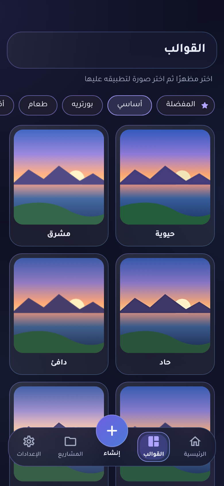
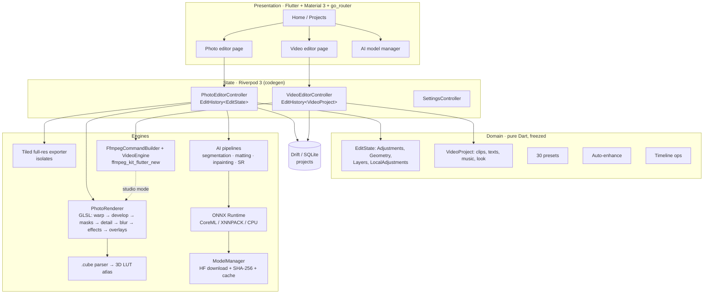

<div align="center">

# Lumora Studio · لومورا ستوديو

**Pro photo & video editing with on-device AI. 100% offline. No cloud, no accounts, no analytics.**

**تحرير احترافي للصور والفيديو بذكاء اصطناعي يعمل على جهازك. بدون إنترنت، بدون سحابة، بدون تتبّع.**

[](https://github.com/CTO-DRS/lumora-studio/actions/workflows/ci.yml)
[](https://github.com/CTO-DRS/lumora-studio/releases/latest)


[English](#english) · [العربية](#arabic)

| Home | Photo editor | AI tools | Templates |
|:---:|:---:|:---:|:---:|
|  |  |  |  |

<sub>v1.2 "calm glass" design, rendered from the app's own widgets (Arabic, dark theme). Design mockups: [home](docs/screenshots/design/mock_home.png) · [editor](docs/screenshots/design/mock_editor.png) · [AI tools](docs/screenshots/design/mock_ai.png). See [docs/screenshots](docs/screenshots/README.md).</sub>

</div>

---

<a name="english"></a>

## English

### Download

Get the latest APK (Android) or unsigned iOS build from **[Releases](https://github.com/CTO-DRS/lumora-studio/releases/latest)**. Most phones need the `arm64-v8a` APK.

### What's new in 1.3 — the smart release

- **Smart edit by typing (Arabic & English)**: a new **Smart** tab (now the first tab of the editor). Type what you want — “make it warmer”, “زد السطوع قليلاً”, “black and white”, “سينمائي”, “remove the background”, “brighten the shadows and add a vignette” — and Lumora turns it into real edits **on your device**, in one undo step. Understands intensities (“a bit”, “كثيرًا”, “+20”, “exposure +1”), several instructions in one sentence, rotate/flip, looks, and every AI tool. No cloud, no account, nothing sent anywhere.
- **Suggestions for this photo**: Lumora looks at the photo (exposure, highlights, colour cast, skin tones, sky, foliage, documents, haze) and offers 3–5 one-tap fixes with live previews — e.g. *Brighten*, *Recover highlights*, *Fix colour*, *Portrait glow*, *Deeper sky*, *Clean document*.
- **Tap to select (MobileSAM)**: tap any object to select it (tap more to add, switch to *Subtract* to remove parts), then **erase** it, **cut it out**, **adjust** only it, or **blur everything else**.
- **Depth blur & Relight (Depth Anything V2)**: a depth map of the scene gives a lens-like background blur that grows with distance, or relights the subject and dims the background.
- **Remove person**: finds the main person and erases them in one tap.
- **iOS release build fixed**: the build no longer depends on the unreachable `download.onnxruntime.ai` host (see `tool/ios_fix_onnxruntime_spm.sh`).
- A **[world-class roadmap](ROADMAP.md)** (Arabic: [docs/ROADMAP.ar.md](docs/ROADMAP.ar.md)) and a one-page **[vision](docs/VISION.md)**.

### What's new in 1.2

- **New look — "calm glass"**: frosted glass surfaces on a calm navy background, soft violet→blue accents and muted tool colours. Easy on the eyes for long sessions; glow is kept for the selected item and the main button only. Light theme included.
- **New navigation**: a floating glass bottom bar with **Home, Templates, Projects, Settings** and a raised **Create** button (photo, video, collage, scanner, batch).
- **Templates tab**: browse every look by category, previewed live, then pick a photo to open it with that look.
- **Projects tab** with search; Home shows recent projects, quick tools and an **AI tools** sheet that runs on your device (download size and progress on each card).
- **Photo editor** redesign: glass top bar, framed photo, preset strip with a glowing selection, gradient sliders and a floating tool bar.
- **New app icon** (Android adaptive + iOS) and a navy launch screen.

### What's new in 1.1

- **Looks on your own photo**: live GPU thumbnails, 45 looks in 9 categories (incl. Food, Vintage, Landscape), favourites, **My presets** (save / import / export), copy & paste edits between photos.
- **Document scanner**: automatic edge detection, perspective correction, shadow removal, magic colour / B&W, multi-page **PDF**.
- **Healing & clone brush**, **selective colour picker**, richer masks.
- **Batch edit** many photos at once and a **collage maker**.
- **Frames, watermark, social sizes** (Instagram, Story, X, WhatsApp) and sharing.
- **Histogram, clipping warnings, history panel**, pinch-zoom with double-tap 1:1.
- **Video**: free-form crop, animated filter strength (keyframes), **stabilisation**, frame → photo, **GIF** export.
- New home screen with quick tools and project management, onboarding, settings, haptics and tablet layouts.

Full list in [CHANGELOG.md](CHANGELOG.md).

### Why Lumora?

- **Private by design.** Every pixel is processed on the device. AI models are downloaded once from public Hugging Face URLs, verified with SHA-256 and cached. Your media is never uploaded.
- **GPU-first.** All photo adjustments are real GLSL fragment shaders (Flutter `FragmentProgram`, Impeller), so the preview updates in real time and the export matches it pixel for pixel.
- **Non-destructive.** Every edit is a serializable recipe (`EditState`) with unlimited undo/redo. Projects are saved locally (Drift/SQLite) and can be reopened at any time.
- **Arabic and English.** Fully localized, with right-to-left layout and correct Arabic shaping, even in text burned into video.

### Features

#### Photo
| Area | What you get |
|---|---|
| Light | Exposure (EV, linear light), contrast (S-curve), highlights, shadows, whites, blacks |
| Color | Temperature/tint (white balance in linear light), vibrance, saturation, **8-band HSL mixer**, split toning, fade |
| Curves | RGB master + per-channel R/G/B curves (monotone cubic, no overshoot) |
| Detail | Sharpen (luma unsharp mask), clarity, structure, dehaze (dark-channel prior), gaussian blur |
| Effects | Vignette (amount/size/roundness/feather), film grain (size, luminance-weighted), chromatic aberration, glitch, duotone |
| LUTs | `.cube` 3D LUT parser (sizes 2–65, DOMAIN support) → GPU atlas with trilinear lookup, intensity control, import your own LUTs, 3 bundled LUTs |
| Looks | **45 built-in presets** in 9 categories (essentials, portrait, food, film, vintage, cinematic, landscape, B&W, creative) shown as **live thumbnails of your photo**, intensity slider, favourites, your own presets (save, rename, import/export JSON) |
| Copy / paste | Copy the edit of one photo and paste it on another (choose: look, crop, masks, text, frame/watermark) |
| Retouch | **Healing brush** (automatic source + colour matching) and **clone stamp**, model-free |
| Selective colour | Tap a colour in the photo, drag up/down to change its hue / saturation / luminance |
| Finishing | **Frames** (border, polaroid, fit 1:1 · 4:5 · 9:16 · 16:9 with colour or blur), rounded corners, **watermark** (text/logo, 9 positions) |
| Inspect | **Histogram** with clipping indicators, red/blue **clipping warnings**, **history panel**, pinch zoom and double-tap 1:1 |
| Geometry | Crop with aspect presets and rule-of-thirds overlay, rotate 90°, straighten (auto-zoom), flip, vertical/horizontal perspective. All done in one inverse-homography shader pass |
| Layers | Text (RTL aware, bold, background pill, colour, size, opacity, rotation, pinch-to-scale), emoji and image stickers, free-hand drawing with eraser |
| Masks | Local adjustments through **brush**, **linear gradient**, **radial gradient** and an **AI subject** mask, each with its own exposure/contrast/colour/clarity/dehaze/blur, plus feather, invert and amount |
| Compare | Press and hold to see the original |
| Export | Full resolution JPEG / PNG / WebP / HEIC, quality control, optional EXIF copy (camera, lens, exposure, GPS, dates; orientation reset), **social sizes** (Instagram 4:5 / 1:1, Story 9:16, X, WhatsApp, Facebook) with crop or pad, share without saving. Images larger than 8192 px are exported **tile by tile** (CPU geometry on an isolate, GPU colour pipeline per tile) |

#### Documents, batch and collage
| Tool | What you get |
|---|---|
| Document scanner | Camera or gallery, automatic edge detection (classic CV, no ML Kit), draggable corners with magnifier, perspective correction, Magic colour / No shadows / Grayscale / B&W, reorder pages, **multi-page PDF** (A4, Letter, fit) or images |
| Batch edit | Apply a look (with strength), copied edits and/or per-photo auto-enhance to many photos; export all at full resolution or a social size |
| Collage | 20 layouts for 1–9 photos, 5 aspect ratios, spacing, margin, rounded corners, colour/gradient backgrounds, pinch to position each photo |

#### On-device AI (ONNX Runtime)
| Tool | Model | Pipeline |
|---|---|---|
| Background removal | U²-Net-p (4.6 MB) | ImageNet norm → 320² → sigmoid → min-max → bilinear upsample → alpha |
| Portrait cutout / subject mask | MODNet int8 (6.6 MB) | short side 512, multiples of 32, mean = std = 0.5 → alpha matte |
| Blur background / portrait retouch | MODNet | subject mask → masked local adjustment (blur, or skin smoothing) |
| Object eraser | MI-GAN (28 MB, default) or LaMa (208 MB, highest quality) | mask dilation → context crop around the strokes → model → feathered composite at full resolution |
| Upscale 4× | Real-ESRGAN General x4v3 (4.9 MB) | 128 px tiles with 16 px overlap → feather-blended stitching |
| Auto enhance | Deterministic | histogram percentiles, gray-world white balance, adaptive vibrance |
| **Tap to select** (1.3) | MobileSAM encoder (28.2 MB) + SAM mask decoder (16.5 MB) | image encoded once (long side 1024) → each tap runs only the decoder → mask → erase / cut out / adjust / blur the rest |
| **Depth blur & relight** (1.3) | Depth Anything V2 Small int8 (27.3 MB) | 518 px (multiples of 14) → robust-normalised relative depth → depth-graded masks |
| **Remove person** (1.3) | MODNet + MI-GAN | person matte → object eraser |
| **Smart edit by typing** (1.3) | none (deterministic intent engine) | Arabic/English normalisation → clauses → intents → one-step edit plan ([docs/SMART_EDIT.md](docs/SMART_EDIT.md)) |
| **Suggestions** (1.3) | none (image statistics) | histogram, colour cast, skin/sky/foliage/paper heuristics → ranked one-tap fixes |

Models are listed in `lib/features/ai/domain/model_registry.dart` with their URL, SHA-256, size and license. Downloads are streamed, hashed on the fly and only kept if the checksum matches. Accelerated execution providers (CoreML on iOS, XNNPACK on Android) are used when available, with fallback to CPU.

#### Video
- Multi-clip timeline with filmstrip thumbnails, pinch-to-zoom and a centre playhead (scrolling scrubs the video)
- Trim, **split at playhead**, merge/reorder, duplicate, delete
- Speed 0.25×–4× (with `atempo` chaining for audio), reverse, **free-form crop** (with aspect locks), rotate
- **Stabilisation** per clip (two-pass FFmpeg vid.stab)
- **Filter strength with keyframes** (animated look), previewed live
- **Save a frame as a photo**, **animated GIF** export
- 9 transitions (`xfade`: fade, dissolve, wipes, slides, circle, zoom, pixelize) with audio cross-fades
- The **same looks and presets as photos**: a real-time preview through a fragment shader on the video texture (`ImageFilter.shader`, Impeller)
- Text overlays rendered by Flutter, so Arabic shaping and emoji are correct, then composited by FFmpeg with start/end times
- Background music with volume, fade in/out and looping, mixed with the original audio (per-clip volume)
- Output aspect (16:9, 9:16, 1:1, 4:3, 4:5), resolution (480p–4K) and frame rate (24/30/60)
- Two export modes:
  - **Fast**: the look is mapped to native FFmpeg filters (`exposure`, `colortemperature`, `eq`, `vibrance`, `curves`, `lut3d`, `unsharp`, `gblur`, `vignette`, `noise`, `rgbashift`)
  - **Studio**: every frame goes through the GPU photo pipeline, for an exact match with the photo editor (HSL, split toning, duotone, glitch and the rest)

### Architecture

Feature-first clean architecture: `domain` (pure Dart, immutable `freezed` models, fully unit tested), `engine`/`data` (GPU, FFmpeg, ONNX, Drift) and `presentation` (Riverpod 3 notifiers with code generation, widgets).



The full write-up, including the render pass order, the GLES y-flip convention and the tiling strategy, is in [`docs/ARCHITECTURE.md`](docs/ARCHITECTURE.md). Dependency choices are explained in [`docs/DEPENDENCIES.md`](docs/DEPENDENCIES.md).

### Tech stack (verified on pub.dev, November 2026)

| Concern | Package |
|---|---|
| UI | Flutter 3.50 · Dart 3.14 · `material_ui` 1.11 (Material 3; Material is now a separate package) · Impeller |
| State | `flutter_riverpod` 3.5 + `riverpod_generator` 4.0 |
| Routing | `go_router` 18.1 |
| Models | `freezed` 4.0 / `json_serializable` 6.15 |
| Persistence | `drift` 2.35 + `drift_flutter` 0.3, `shared_preferences` |
| AI runtime | `flutter_onnxruntime` 1.9 |
| Video engine | `ffmpeg_kit_flutter_new_min_gpl` 2.7 (FFmpeg 8.1.2) |
| Playback | `video_player` 2.14 |
| Image IO | `image` 4.13, `flutter_image_compress` 2.5 (WebP/HEIC), `native_exif` 0.8, `gal` 3.0 |
| Lints | `very_good_analysis` 11 |

### Build & run

```bash
# Flutter 3.50 stable (Dart 3.14)
flutter pub get
dart run build_runner build      # freezed / json / riverpod / drift
flutter gen-l10n                  # Arabic + English
flutter analyze
flutter test                      # unit + widget + real GPU shader tests

flutter run                       # device or emulator
flutter build apk --release --split-per-abi
bash tool/ios_fix_onnxruntime_spm.sh   # once after pub get on macOS (see below)
flutter build ios --release --no-codesign
```

**iOS note:** `flutter_onnxruntime`'s Swift package pulls an `onnxruntime-extensions` archive from `download.onnxruntime.ai`, which currently serves an invalid TLS certificate (CocoaPods uses the same host for `onnxruntime-c`). `tool/ios_fix_onnxruntime_spm.sh` points the plugin at a local checkout of the pinned Swift package whose archive URL uses Microsoft's origin storage — the same file, still verified by its SHA-256 checksum. CI and the release workflow run it automatically.

Requirements: Android 8.0+ (API 26; HEIC export needs API 28+) and iOS 16+. Shader effects need Impeller, which is the default on both platforms.

CI (`.github/workflows/ci.yml`) runs code generation, format, analyze and tests, then builds split-per-ABI Android APKs and an unsigned iOS app. Dependabot keeps pub, Gradle and Actions dependencies up to date.

**Releases** (`.github/workflows/release.yml`): push a tag such as `v1.1.0` (or run the workflow manually from the Actions tab) and it tests, builds the split-per-ABI APKs and an unsigned iOS `Runner.app` zip, and publishes them with checksums and the changelog section to a GitHub Release.

### Licensing note

Lumora's source code is MIT. The default video engine package, `ffmpeg_kit_flutter_new_min_gpl`, bundles x264 (GPL), so **binaries you distribute with it are covered by the GPL-3.0**. For MIT/LGPL-only binaries, swap to `ffmpeg_kit_flutter_new_min` and use `VideoEncoder.mediacodec` / `VideoEncoder.videotoolbox`; the API is identical. AI models keep their own licenses, listed in the model manager screen and in `model_registry.dart`.

---

<a name="arabic"></a>

<div dir="rtl">

## العربية

### التحميل

حمّل أحدث نسخة APK للأندرويد أو نسخة iOS غير الموقّعة من صفحة **[الإصدارات](https://github.com/CTO-DRS/lumora-studio/releases/latest)**. أغلب الهواتف تحتاج ملف `arm64-v8a`.

### الجديد في الإصدار 1.3 — إصدار الذكاء

- **التعديل الذكي بالكتابة (عربي وإنجليزي)**: تبويب جديد **«ذكي»** أصبح أول تبويب في المحرر. اكتب ما تريد — «اجعلها أدفأ»، «زد السطوع قليلاً»، «أبيض وأسود»، «سينمائي»، «أزل الخلفية»، «افتح الظلال وأضف تظليلًا للحواف» — فيحوّله لومورا إلى تعديلات حقيقية **على جهازك** في خطوة تراجع واحدة. يفهم الشدة («قليلًا»، «كثيرًا»، «+20»)، وعدة أوامر في جملة واحدة، والتدوير والقلب، والأنماط، وكل أدوات الذكاء الاصطناعي. بلا سحابة ولا حساب، ولا يُرسل أي شيء.
- **مقترحات لهذه الصورة**: يحلّل لومورا الصورة (التعريض، الإضاءات المحروقة، انحراف الألوان، لون البشرة، السماء، الخضرة، المستندات، الضباب) ويقترح من 3 إلى 5 إصلاحات بلمسة واحدة مع معاينات حيّة، مثل *إضاءة أفضل* و*استعادة الإضاءات* و*تصحيح الألوان* و*إشراقة البورتريه* و*سماء أعمق* و*مستند نظيف*.
- **التحديد بلمسة (MobileSAM)**: المس أي عنصر لتحديده (المس مرة أخرى للإضافة، واختر «طرح» لاستبعاد أجزاء)، ثم **امسحه** أو **قصّه** أو **عدّله وحده** أو **موّه الباقي**.
- **تمويه بالعمق وإعادة الإضاءة (Depth Anything V2)**: خريطة عمق للمشهد تعطي تمويهًا للخلفية يزداد مع المسافة كالعدسات الاحترافية، أو تضيء الموضوع وتخفّض إضاءة الخلفية.
- **إزالة شخص**: يعثر على الشخص الرئيسي ويمسحه بلمسة واحدة.
- **إصلاح بناء iOS**: لم يعد البناء يعتمد على خادم `download.onnxruntime.ai` المتعذّر الوصول إليه.
- **[خارطة طريق عالمية](docs/ROADMAP.ar.md)** و**[رؤية في صفحة واحدة](docs/VISION.md)**.

### الجديد في الإصدار 1.2

- **مظهر جديد "زجاج هادئ"**: أسطح زجاجية شفافة على خلفية كحلية هادئة، ولمسات بنفسجية وزرقاء ناعمة، وألوان أدوات هادئة. مريح للعين في جلسات التحرير الطويلة، والتوهج فقط للعنصر المحدد والزر الرئيسي. مع وضع فاتح.
- **تنقّل جديد**: شريط سفلي زجاجي عائم فيه **الرئيسية، القوالب، المشاريع، الإعدادات** وزر **إنشاء** بارز (صورة، فيديو، تجميعة، ماسح، دفعة).
- **تبويب القوالب**: تصفّح كل الأنماط حسب الفئة بمعاينة حيّة، ثم اختر صورة لتفتحها بهذا النمط.
- **تبويب المشاريع** مع البحث، والرئيسية تعرض المشاريع الأخيرة والأدوات السريعة ولوحة **أدوات الذكاء الاصطناعي** التي تعمل على جهازك (حجم التنزيل والتقدّم على كل بطاقة).
- **محرر الصور** بتصميم جديد: شريط علوي زجاجي، صورة بإطار، شريط أنماط بتحديد متوهّج، منزلقات متدرجة، وشريط أدوات عائم.
- **أيقونة جديدة للتطبيق** (Android التكيّفية وiOS) وشاشة بدء كحلية.

### الجديد في الإصدار 1.1

- **الأنماط على صورتك أنت**: معاينات حيّة على كرت الشاشة، ‏45 نمطاً في 9 فئات (منها الطعام والعتيق والطبيعة)، المفضلة، **أنماطي** (حفظ / استيراد / تصدير)، ونسخ التعديلات ولصقها بين الصور.
- **ماسح المستندات**: اكتشاف الحواف تلقائياً، تصحيح المنظور، إزالة الظلال، ألوان سحرية / أبيض وأسود، وتصدير **PDF** متعدد الصفحات.
- **فرشاة المعالجة والاستنساخ**، و**منتقي اللون الانتقائي**، وأقنعة أغنى.
- **تعديل دفعة** من الصور مرة واحدة، و**صانع تجميعات الصور**.
- **إطارات وعلامة مائية ومقاسات الشبكات الاجتماعية** (إنستغرام، القصص، X، واتساب) والمشاركة.
- **المدرج التكراري وتحذيرات القص اللوني وسجل التعديلات**، والتكبير بإصبعين مع النقر المزدوج لعرض 1:1.
- **الفيديو**: قص حر، قوة فلتر متحركة بإطارات مفتاحية، **تثبيت الاهتزاز**، حفظ إطار كصورة، وتصدير **GIF**.
- شاشة رئيسية جديدة بأدوات سريعة وإدارة للمشاريع، ونصائح البداية، وإعدادات، واهتزاز عند اللمس، وتصميم للأجهزة اللوحية.

### لماذا لومورا؟

- **الخصوصية أولاً:** تتم معالجة كل بكسل على جهازك. تُنزَّل نماذج الذكاء الاصطناعي مرة واحدة من روابط Hugging Face العامة، ويُتحقق منها بـ SHA-256 ثم تُحفظ محلياً. صورك ومقاطعك لا تُرفع أبداً.
- **معالجة على كرت الشاشة:** كل تعديلات الصور مكتوبة كـ GLSL Shaders حقيقية (Flutter FragmentProgram مع Impeller)، لذلك تتحدث المعاينة فوراً، ويطابق التصدير ما تراه تماماً.
- **تحرير غير متلف:** كل تعديل وصفة قابلة للحفظ، مع تراجع وإعادة بلا حدود. تُحفظ المشاريع محلياً (Drift/SQLite) ويمكن فتحها لاحقاً.
- **عربي وإنجليزي:** واجهة مترجمة بالكامل مع دعم الاتجاه من اليمين لليسار، وتشكيل صحيح للحروف العربية حتى في نصوص الفيديو.

### المزايا

**الصور:**
- الإضاءة: التعريض، التباين، الإضاءات العالية، الظلال، الأبيض، الأسود
- الألوان: الحرارة والصبغة، الحيوية، التشبع، **خلاط HSL بثمانية نطاقات**، التلوين المنفصل، البهتان
- المنحنيات: منحنى عام ومنحنيات منفصلة للأحمر والأخضر والأزرق
- التفاصيل: الحدة، الوضوح، البنية، إزالة الضباب، التمويه
- التأثيرات: التظليل الجانبي، الحبيبات، الانحراف اللوني، التشويش الرقمي، الثنائي اللوني
- جداول الألوان LUT: قراءة ملفات ‎.cube وتطبيقها على GPU، مع إمكانية استيراد ملفاتك
- **45 نمطاً جاهزاً** في 9 فئات تُعرض **كمعاينات حيّة لصورتك**، مع الشدة والمفضلة و**أنماطك الخاصة** (حفظ، إعادة تسمية، استيراد وتصدير JSON)
- **نسخ التعديلات ولصقها** بين الصور مع اختيار الأجزاء
- **فرشاة المعالجة** (اختيار المصدر تلقائياً ومطابقة الألوان) و**الاستنساخ** بدون نماذج ذكاء اصطناعي
- **اللون الانتقائي**: اضغط على لون في الصورة واسحب لتغيير درجته أو تشبعه أو إضاءته
- **الإطارات** (حدود، بولارويد، احتواء 1:1 و4:5 و9:16 و16:9 بلون أو بصورة ضبابية)، زوايا دائرية، و**علامة مائية** نصية أو شعار
- **المدرج التكراري** وتحذيرات القص اللوني، و**سجل التعديلات** للرجوع إلى أي خطوة، والتكبير حتى 1:1
- القص والتدوير وتعديل الميل والقلب وتصحيح المنظور
- النصوص (تدعم العربية) والملصقات والرسم الحر
- الأقنعة: فرشاة، تدرج خطي، تدرج دائري، وقناع العنصر بالذكاء الاصطناعي
- المقارنة قبل وبعد بالضغط المطوّل
- التصدير بالدقة الكاملة بصيغ JPEG وPNG وWebP وHEIC مع الاحتفاظ ببيانات EXIF اختيارياً، ومقاسات الشبكات الاجتماعية (قص أو احتواء)، والمشاركة المباشرة، وتقسيم الصور الضخمة إلى مربعات

**المستندات والدفعات والتجميعات:**
- ماسح مستندات: كاميرا أو معرض، اكتشاف الحواف تلقائياً، زوايا قابلة للسحب مع مكبّر، تصحيح المنظور، ألوان سحرية / بدون ظلال / رمادي / أبيض وأسود، ترتيب الصفحات، وتصدير PDF متعدد الصفحات
- تعديل دفعة: نمط أو تعديلات منسوخة أو تحسين تلقائي لكل صورة، وتصدير الكل بالدقة الكاملة
- تجميعات الصور: 20 تصميماً لـ 1–9 صور، 5 نسب أبعاد، مسافات وهوامش وزوايا وخلفيات ملونة أو متدرجة

**الذكاء الاصطناعي على الجهاز:**
- إزالة الخلفية (U²-Net) وقص الأشخاص (MODNet)
- تمويه الخلفية وتنقيح البورتريه
- ممحاة العناصر (MI-GAN أو LaMa)
- تكبير الصور 4× (Real-ESRGAN)
- التحسين التلقائي
- **التعديل الذكي بالكتابة** بالعربية والإنجليزية، و**المقترحات الذكية** لكل صورة (1.3)
- **التحديد بلمسة** (MobileSAM) ثم المسح أو القص أو التعديل أو تمويه الباقي (1.3)
- **تمويه بالعمق** و**إعادة الإضاءة** (Depth Anything V2) و**إزالة شخص** (1.3)

**الفيديو:**
- خط زمني متعدد المقاطع مع صور مصغرة
- قص المدة، التقسيم، الدمج وإعادة الترتيب، التكرار، الحذف
- السرعة من 0.25× إلى 4×، العكس، **القص الحر**، التدوير
- **تثبيت الاهتزاز** لكل مقطع (vid.stab على مرحلتين)
- **قوة الفلتر بإطارات مفتاحية** (فلتر متحرك) مع معاينة مباشرة
- **حفظ إطار كصورة** وتصدير **GIF** متحرك
- 9 انتقالات بين المقاطع مع مزج الصوت
- نفس أنماط وفلاتر الصور مع معاينة فورية على كرت الشاشة
- نصوص فوق الفيديو بخطوط عربية صحيحة
- موسيقى خلفية مع التحكم في الصوت والتلاشي
- نسب العرض (16:9، 9:16، 1:1، 4:3، 4:5) والدقة حتى 4K
- تصدير سريع بفلاتر FFmpeg، أو تصدير «استوديو» يطابق محرر الصور تماماً

### البناء والتشغيل

</div>

```bash
flutter pub get
dart run build_runner build
flutter gen-l10n
flutter test
flutter run
```

<div dir="rtl">

يتطلب Android 8.0 أو أحدث، وiOS 16 أو أحدث. لإصدار نسخة جديدة: ادفع وسماً مثل `v1.1.0` (أو شغّل سير العمل Release يدوياً) فتُبنى ملفات APK ونسخة iOS وتُنشر تلقائياً في صفحة الإصدارات. تفاصيل البنية في `docs/ARCHITECTURE.md`، وخارطة الطريق في `ROADMAP.md`، ونرحب بمساهماتكم (راجع `CONTRIBUTING.md`).

**الترخيص:** الكود المصدري مرخّص بـ MIT. انتبه إلى أن حزمة FFmpeg الافتراضية تتضمن x264 المرخّص بـ GPL، لذا تخضع النسخ التنفيذية الموزعة لـ GPL-3.0. يمكنك التبديل إلى نسخة LGPL كما هو موضح في القسم الإنجليزي.

</div>

---

© 2026 CTO-DRS · MIT License
